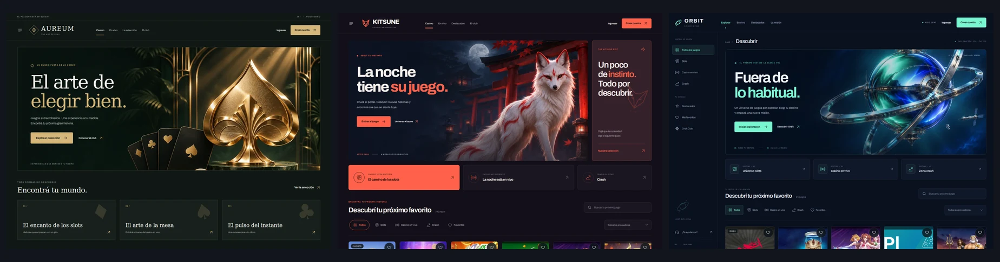

# Aureum, Kitsune y Orbit

Tres plantillas originales para Maker, editables en computadora y celular. Se suman a las diecisiete existentes y usan un catálogo curado de juegos con imágenes locales del repositorio.

| Plantilla | Composición | Paleta inicial |
| --- | --- | --- |
| Aureum | Club editorial, títulos serif y portada amplia. | Verde profundo, champán y marfil. |
| Kitsune | Santuario japonés nocturno, zorro blanco y bloques de descubrimiento. | Tinta y bermellón. |
| Orbit | Estación espacial y navegación lateral en computadora. | Azul profundo y menta. |

Las portadas son ilustraciones originales sin textos incrustados. Títulos, descripciones, botones y navegación permanecen en HTML. Cada diseño permite cambiar nombre, logo, colores, tipografía, fondo e imágenes mediante los controles existentes del Maker.

## Vistas previas

Capturas reales del navegador, con los ajustes iniciales de cada plantilla:



| Plantilla | Escritorio, 1440 px | Celular, 393 px |
| --- | --- | --- |
| Aureum | [Ver captura](previews/aureum-desktop.webp) | [Ver captura](previews/aureum-mobile.webp) |
| Kitsune | [Ver captura](previews/kitsune-desktop.webp) | [Ver captura](previews/kitsune-mobile.webp) |
| Orbit | [Ver captura](previews/orbit-desktop.webp) | [Ver captura](previews/orbit-mobile.webp) |

## Interacciones y edición

Los tres diseños comparten búsqueda, categorías, filtro de proveedor, favoritos de sesión y diálogos de demostración. Los juegos abren únicamente `/api/muestra/juego-demo`; no se conectan motores externos, pagos ni cuentas reales. Las acciones de cuenta y soporte son ejemplos locales.

La edición visual conserva el aislamiento por `aureum:lobby`, `kitsune:lobby` y `orbit:lobby`. Los cambios se guardan en el navegador y se incluyen en los archivos de ajustes. Las miniaturas se identifican por su recurso original, para conservar la edición al filtrar el catálogo. El panel sigue siendo compartido, con los ajustes separados por plantilla y pantalla.

## Archivos

- `scripts/signature-lobbies-page.mjs`: genera las tres vistas mediante `signatureLobbiesPage(slug, name)`.
- `scripts/install-lobby-templates.mjs`: registra nombres, paletas, rutas y opciones del selector.
- `public/muestra/signature-lobbies.css`: estilos comunes y composición de cada tema.
- `public/muestra/signature-lobbies.js`: navegación, catálogo, diálogos y protocolo `window.__demo`.
- `public/muestra/signature-catalog.mjs`: catálogo curado y filtros combinados.
- `public/muestra/signature/assets/<slug>-hero.webp`: portadas originales de cada diseño.

Las páginas incluyen `data-catalog` y `design-editor.js` para funcionar dentro del Maker y como vistas independientes. Todos los recursos son locales; no se agregan dependencias de ejecución ni servicios remotos.

## Regenerar

Desde la raíz del repositorio:

```sh
node scripts/install-lobby-templates.mjs
```

El comando genera `public/muestra/aureum.html`, `kitsune.html` y `orbit.html`, y actualiza el registro y el selector del Maker. Editar el generador para cambiar la estructura; las modificaciones directas a estos HTML se reemplazan al regenerar. Una segunda ejecución debe dejar los archivos sin cambios.

## Verificación

```sh
npm test
npm run dev
```

Con el servidor activo, Playwright disponible y `WORKSPACE_NODE_MODULES` apuntando al directorio de paquetes:

```sh
WORKSPACE_NODE_MODULES=... DEMO_ORIGIN=http://127.0.0.1:8787 node tests/signature-browser-smoke.cjs
WORKSPACE_NODE_MODULES=... DEMO_ORIGIN=http://127.0.0.1:8787 PLAYWRIGHT_CHANNEL=chromium node tests/template-picker-browser-smoke.cjs
WORKSPACE_NODE_MODULES=... DEMO_ORIGIN=http://127.0.0.1:8787 PLAYWRIGHT_CHANNEL=chromium node tests/element-editor-coverage-browser.cjs
npm run test:runtime
```

Los tres recorridos también admiten `BROWSER_EXECUTABLE=/ruta/al/chromium`. Cuando se define, ese ejecutable tiene prioridad sobre `PLAYWRIGHT_CHANNEL`.

Revisar los tres temas a 1440, 768, 393 y 320 píxeles: lectura sobre las portadas, nombres largos y logos, teclado y foco, menús, diálogos y ausencia de desplazamiento horizontal. El recorrido de navegador comprueba las interacciones, personalización y edición; la revisión de capturas confirma el acabado visual. `npm run check:assets` complementa la revisión de recursos, pero no sustituye la validación de las imágenes cargadas dinámicamente.

### Resultado de esta entrega

- `npm test`: 46 pruebas aprobadas.
- `npm run test:runtime`: 4 pruebas aprobadas contra el Worker local.
- `signature-browser-smoke.cjs`: los tres temas, 24 portadas cargadas por tema, filtros combinados, favoritos, demos, errores de lanzamiento, personalización, menús, cuatro anchos y ausencia de solicitudes externas o errores de recursos.
- Integración con Maker: veinte opciones, edición de texto e imagen, guardado y recarga, aislamiento entre plantillas, panel compartido, selección de Fenarys y cierre de diálogos con Escape sin salir de pantalla completa.
- `template-picker-browser-smoke.cjs`: selector, teclado, recarga, panel/lobby y selección móvil aprobados.
- `element-editor-coverage-browser.cjs`: selección y edición de texto aprobadas en las veinte plantillas y en la vista móvil.
- Revisión visual de nueve capturas: escritorio, tablet y celular para cada diseño. Revisión independiente del registro y de la edición de tarjetas dinámicas, con conservación tras filtrar y recargar.

Las portadas originales suman 246.378 bytes en WebP. El catálogo reutiliza imágenes existentes, sin duplicarlas.
